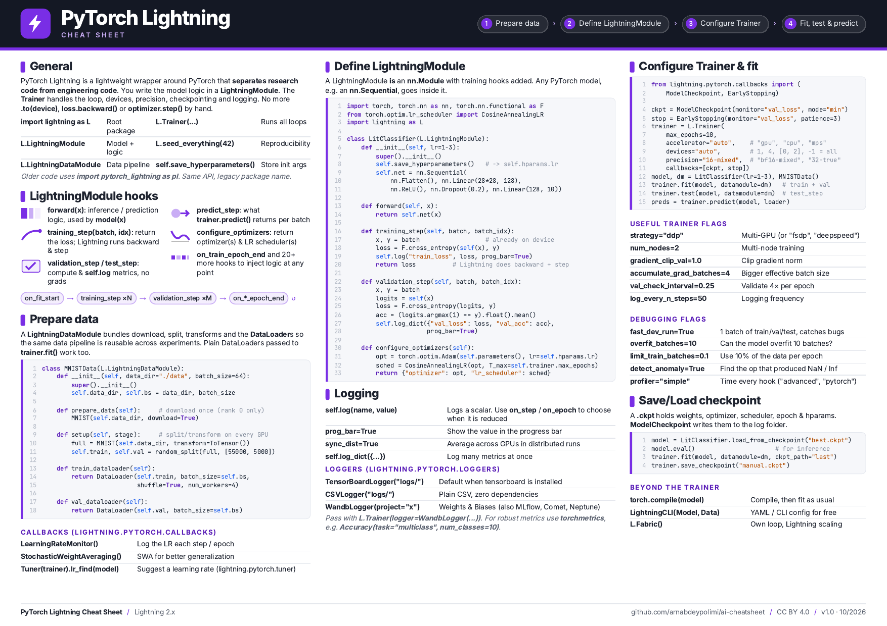
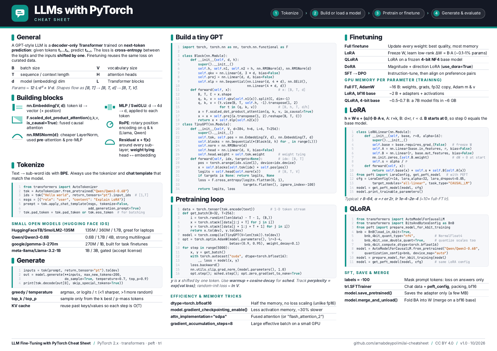
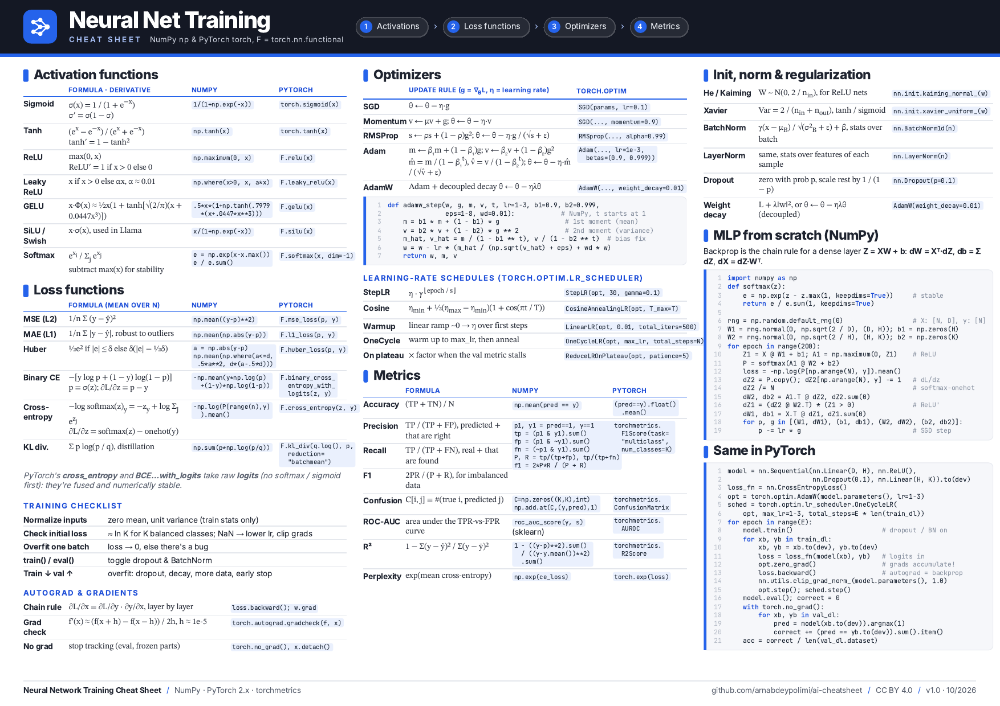

# AI Cheat Sheets (PDF): PyTorch, PyTorch Lightning, LLM Fine-Tuning (LoRA / QLoRA), Neural Network Training

Free, printable, **one-page AI cheat sheets** for deep learning and LLMs with **PyTorch**. Each sheet is a single landscape A4 page with copy-paste code, formulas and the flags you actually use.

| Cheat sheet | What it covers | Download |
|---|---|---|
| **PyTorch Lightning Cheat Sheet** | LightningModule hooks, LightningDataModule, Trainer, callbacks, logging, checkpoints, multi-GPU, debugging flags | [PDF](pdf/pytorch-lightning-cheatsheet.pdf) · [PNG](images/pytorch-lightning-cheatsheet.png) · [Web](https://www.arnabdey.co/ai-cheatsheet/pytorch-lightning-cheatsheet.html) |
| **LLM Fine-Tuning Cheat Sheet (LoRA, QLoRA)** | Tiny GPT from scratch, pretraining loop, tokenizers, small LLMs, generation, LoRA, QLoRA, PEFT, TRL SFT, GPU memory math | [PDF](pdf/llm-finetuning-lora-qlora-pytorch-cheatsheet.pdf) · [PNG](images/llm-finetuning-lora-qlora-pytorch-cheatsheet.png) · [Web](https://www.arnabdey.co/ai-cheatsheet/llm-finetuning-lora-qlora-pytorch-cheatsheet.html) |
| **Neural Network Training Cheat Sheet (NumPy & PyTorch)** | Activation functions, loss functions, optimizers, LR schedules, metrics, init and normalization, backprop from scratch | [PDF](pdf/neural-network-training-cheatsheet-numpy-pytorch.pdf) · [PNG](images/neural-network-training-cheatsheet-numpy-pytorch.png) · [Web](https://www.arnabdey.co/ai-cheatsheet/neural-network-training-cheatsheet-numpy-pytorch.html) |

Browse all three online: **https://www.arnabdey.co/ai-cheatsheet/**

---

## PyTorch Lightning Cheat Sheet

[](pdf/pytorch-lightning-cheatsheet.pdf)

A quick reference for **PyTorch Lightning 2.x** (`import lightning as L`):

- **LightningModule**: `training_step`, `validation_step`, `test_step`, `predict_step`, `configure_optimizers` with an LR scheduler
- **LightningDataModule**: `prepare_data`, `setup`, `train_dataloader`, `val_dataloader`
- **Trainer**: `accelerator`, `devices`, `precision="16-mixed"`, `strategy="ddp"`/`"fsdp"`, gradient clipping, gradient accumulation
- **Callbacks**: `ModelCheckpoint`, `EarlyStopping`, `LearningRateMonitor`, `lr_find`
- **Logging**: `self.log`, `self.log_dict`, TensorBoard / CSV / Weights & Biases loggers
- **Debugging**: `fast_dev_run`, `overfit_batches`, `limit_train_batches`, `detect_anomaly`, profiler
- **Checkpoints**: `load_from_checkpoint`, resume with `ckpt_path="last"`, plus `torch.compile`, `LightningCLI` and `Fabric`

## LLM Fine-Tuning Cheat Sheet: LoRA, QLoRA and small LLMs in PyTorch

[](pdf/llm-finetuning-lora-qlora-pytorch-cheatsheet.pdf)

How to build, pretrain and fine-tune **small language models** with PyTorch, Hugging Face `transformers`, `peft` and `trl`:

- **Tiny GPT from scratch**: decoder-only Transformer with `F.scaled_dot_product_attention`, `nn.RMSNorm` and weight tying
- **Pretraining loop**: next-token batches, AdamW, bf16 autocast, gradient clipping, `torch.compile`
- **Tokenizers and chat templates**: `AutoTokenizer`, `apply_chat_template`
- **Small open models**: SmolLM2, Qwen3-0.6B, Gemma 3 270M, Llama 3.2 1B
- **Generation**: greedy, temperature, top-k, top-p, KV cache
- **Fine-tuning methods**: full fine-tuning vs **LoRA**, **QLoRA**, DoRA, SFT and DPO
- **LoRA from scratch** plus `LoraConfig` / `get_peft_model`
- **QLoRA**: 4-bit NF4, double quantization, `prepare_model_for_kbit_training`
- **GPU memory per parameter** for full fine-tuning, LoRA and QLoRA; saving and merging adapters

## Neural Network Training Cheat Sheet: activations, losses, optimizers, metrics

[](pdf/neural-network-training-cheatsheet-numpy-pytorch.pdf)

Every formula comes with **NumPy** and **PyTorch** code side by side:

- **Activation functions**: Sigmoid, Tanh, ReLU, Leaky ReLU, GELU, SiLU / Swish, Softmax, with derivatives
- **Loss functions**: MSE, MAE, Huber, binary cross-entropy, cross-entropy, KL divergence, plus their gradients
- **Optimizers**: SGD, Momentum, RMSProp, Adam, AdamW update rules, and an AdamW step in NumPy
- **Learning-rate schedules**: StepLR, cosine annealing, warmup, OneCycle, ReduceLROnPlateau
- **Metrics**: accuracy, precision, recall, F1, confusion matrix, ROC-AUC, R², perplexity
- **Initialization and regularization**: He / Kaiming, Xavier, BatchNorm, LayerNorm, dropout, weight decay
- **Backpropagation from scratch**: a 2-layer MLP in NumPy, and the same model trained in PyTorch
- **Training checklist**: what to check first when a model won't train

---

## Edit or rebuild

Each sheet is a single self-contained HTML file in the repo root. To regenerate a PDF, print it with headless Chrome:

```bash
google-chrome --headless --no-pdf-header-footer \
  --print-to-pdf=pdf/pytorch-lightning-cheatsheet.pdf pytorch-lightning-cheatsheet.html
```

Found a mistake or want a new sheet? Open an issue or a pull request. If these help you, a ⭐ helps other people find them.

## License

[CC BY 4.0](LICENSE): free to share and adapt, including commercially, with attribution to **Arnab Dey** and a link to this repo.

<!-- keywords: pytorch cheat sheet, pytorch cheatsheet pdf, pytorch lightning cheat sheet, llm cheat sheet, lora cheat sheet, qlora cheat sheet, fine-tuning llm cheat sheet, deep learning cheat sheet, machine learning cheat sheet, neural network cheat sheet, activation functions cheat sheet, loss functions cheat sheet, optimizers cheat sheet, numpy cheat sheet -->
